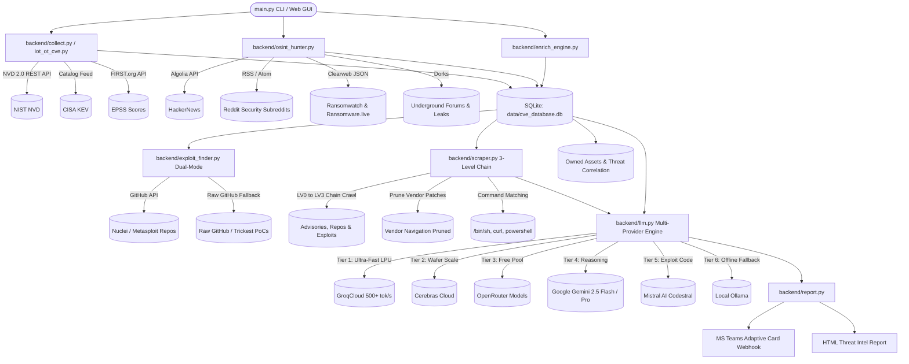
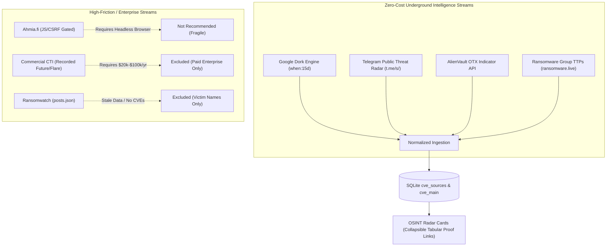

# 🛡️ Automated CVE Threat Intel & OSINT Analyzer (ATI V2) - Documentation

> **Version:** 2.0  
> **Author:** Created with love by Chiranjib and Team  
> **Entrypoint:** `main.py`  
> **Primary Storage:** SQLite (`data/cve_database.db`)  
> **AI Architecture:** Multi-Provider (GroqCloud + Cerebras + OpenRouter + Google Gemini + Mistral AI + Local Ollama)

---

## 1. Executive Summary

**Automated Threat Intel Analyzer (ATI V2)** is an end-to-end cyber threat intelligence and vulnerability management platform. It continuously tracks, enriches, classifies, and alerts on emerging vulnerabilities (CVEs) across multiple threat vectors:

- **Official Feeds:** NIST NVD 2.0 API (with automatic 90-day window slicing), full persistent CISA Known Exploited Vulnerabilities (KEV) catalog with exploitation timelines, and FIRST.org Exploit Prediction Scoring System (EPSS) with parallel non-blocking batch enrichment.
- **Weaponized Repositories (Dual-Mode):** Automated hunting across ProjectDiscovery Nuclei templates, Metasploit modules, Trickest CVE PoCs, and public GitHub code using GitHub Code Search API with direct raw repository scraping fallback (`raw.githubusercontent.com/...`).
- **8-Stream OSINT & Clearweb Dark Web Harvester:** Real-time extraction of trending vulnerabilities discussed across HackerNews, curated security Subreddits (`r/netsec`, `r/blueteamsec`, `r/redteamsec`, `r/cybersecurity`), real-time syndicated X (Twitter) feeds, security media newsrooms, and clearweb mirrors of underground ransomware sites (Ransomwatch `posts.json` and Ransomware.live API) with zero Tor overhead.
- **3-Level Deep Link Chain Harvester (LV0 → LV3):** Recursively crawls technical advisory links up to 3 levels deep to locate weaponized `.py` or `.sh` exploit scripts, command execution strings (`/bin/sh`, `curl`, `powershell`), and prunes pure vendor patch portal navigation traps.
- **Multi-Provider AI Intelligence (`backend/llm.py`):** Cascades across zero-cost inference providers (GroqCloud LPU, Cerebras Cloud, OpenRouter Free Pool, Google Gemini Studio, Mistral AI Codestral, Local Ollama) with dynamic key cooldown scheduling (`HTTP 429` scheduler) and fast-path heuristic URL classification (`POC`, `VENDOR_FIX`, `INFO`).
- **On-Demand Technical & AI Threat Enrichment (`backend/enrich_engine.py`):** Interactive, user-controlled database maintenance engine (non-cron) that backfills NIST technical details, batch-enriches EPSS scores, and analyzes unanalyzed records, featuring graceful user cancellation (`q` + Enter or Ctrl+C in CLI, UI toggle).
- **Internal Owned Assets Inventory:** Asset tracking table (`owned_assets`) and correlation bridge (`asset_cve_matches`) mapping enterprise servers, firewalls, and OT controllers against active CVEs and weaponized exploits.
- **Alerting & Reporting:** Instant real-time alerts via Microsoft Teams Adaptive Cards (Webhooks) and comprehensive interactive HTML report generation.
- **Dual CLI & Cyber Command Center Web GUI:** Run via terminal (`python main.py ...`) or launch the real-time web dashboard (`python main.py --gui`).

---

## 2. System Architecture & Flow



---

## 3. Directory Structure

```text
ATI V2/
├── .env                              # Active environment configuration (API keys & webhooks)
├── .env copy                         # Template environment config
├── flows.md                          # Architecture flows & 3-level chain harvester diagrams
├── documentation.md                  # Comprehensive project documentation & architecture guide
├── Example.md                        # CLI scan scenarios and examples
├── main.py                           # Primary CLI orchestrator & Web GUI launcher
├── x.py                              # Standalone codebase & documentation PDF compiler
├── report_output.html                # Generated executive HTML threat report
├── requirements.txt                  # Python dependencies
├── backend/                          # Modular Python backend engines & helpers
│   ├── __init__.py
│   ├── llm.py                        # Centralized 6-tier multi-provider AI cascade with 429 cooldowns
│   ├── collect.py                    # NIST NVD (90-day auto-slice), CISA KEV, and EPSS ingestion
│   ├── db_manager.py                 # SQLite schema, owned assets tables, indexes & connection manager
│   ├── enrich_engine.py              # On-demand non-cron technical & AI threat enrichment engine
│   ├── exploit_finder.py             # Dual-mode exploit hunter (GitHub API + Raw Scraper fallback)
│   ├── ioc_engine.py                 # Zero-cost parallel IoC validator (ThreatFox/MB/URLhaus/Shodan)
│   ├── iot_ot_cve.py                 # IoT, SCADA, ICS, and OT hardware collector
│   ├── osint_hunter.py               # 8-stream parallel OSINT & clearweb ransomware monitor
│   ├── report.py                     # HTML report compiler & Teams Webhook dispatcher
│   ├── scraper.py                    # 3-level deep link chain crawler & command string matcher
│   └── server.py                     # FastAPI REST API, Owned Assets CRUD & SSE streaming server
├── data/
│   ├── cve_database.db               # SQLite persistent storage database (WAL Mode)
│   ├── known_exploit_links_url.txt   # Fast-path heuristic signatures for weaponized repositories
│   └── known_advisory_links_url.txt  # Fast-path heuristic signatures for vendor patch portals
├── execution_temp/                   # RAM-efficient ephemeral disk buffering for scraped artifacts
├── logs/                             # Centralized operational logs
│   ├── cve_analyzer.log              # Main pipeline and LLM analysis logs
│   ├── apicall.log                   # Outgoing HTTP/REST telemetry logs
│   └── exploitfinder.log             # Exploit search logs
└── static/                           # Cyber Command Center Web Frontend
    ├── app.js                        # Single-page application controller
    ├── index.html                    # Command center layout & views
    └── style.css                     # Obsidian dark theme stylesheet
```

---

## 4. Module Deep-Dive

### 4.1. `main.py` (Root Orchestrator & CLI / GUI Entrypoint)
- **CLI Interface:** Implements `argparse` to handle targeted CVE lookups, date ranges, OSINT sweeps, and IoT/OT filters.
- **Web GUI Launcher:** Launches the FastAPI backend (`backend/server.py`) and opens the Cyber Command Center UI via `--gui` / `--web`.
- **Pipeline Coordinator:** Routes tasks to `backend.collect`, `backend.exploit_finder`, `backend.scraper`, and `backend.llm`.

### 4.2. `backend/llm.py` (Multi-Provider Free LLM Cascade Engine)
- **6-Tier Zero-Cost Provider Cascade:** Sequentially cascades across available free-tier LLM providers in priority order:
  1. **GroqCloud LPU Inference:** Ultra-fast LPU inference (500+ tokens/sec) serving `llama-3.3-70b-versatile`, `llama-3.1-8b-instant`, and `mixtral-8x7b-32768`.
  2. **Cerebras Cloud:** High-speed wafer-scale inference serving `llama-3.3-70b` and `llama-3.1-8b`.
  3. **OpenRouter Free Pool:** Multi-model pool across 7+ models (`nvidia/nemotron-3-super-120b-a12b:free`, `google/gemma-4-31b-it:free`, `minimax/minimax-m3:free`, `z-ai/glm-5.2:free`).
  4. **Google Gemini AI Studio:** Deep reasoning models (`gemini-2.5-flash`, `gemini-flash-latest`, `gemini-2.5-pro`).
  5. **Mistral AI:** High-precision exploit code and script analysis (`codestral-latest`, `mistral-small-latest`).
  6. **Local Ollama:** 100% offline, privacy-preserving fallback running on `http://localhost:11434/v1`.
- **Dynamic Key Cooldown Scheduler (`_key_cooldowns`):** When any API key encounters an `HTTP 429` (Rate Limited) or daily quota exhaustion, it is automatically marked with a cooldown timestamp (60s default, 24h on daily limit). All subsequent requests skip cooled-down keys instantly (0.00s) without wasteful network roundtrips.
- **Fast-Path Heuristic URL Classifier (`ai_link_classifier`):** Pre-classifies reference URLs against curated domain lists (`known_exploit_links_url.txt` and `known_advisory_links_url.txt`), classifying verified exploit repos as `POC` and vendor security portals as `VENDOR_FIX` instantly with zero LLM token consumption.
- **Telemetry & Health Registry (`get_llm_status()`):** Live tracking of per-provider response latency averages, active key counts, success/failure counters, and active model lists surfaced directly in the Web UI.
- **Strict XML Parsing & Boundary Extraction:** Enforces `<summary>`, `<action>`, `<poc>`, `<vendor>`, `<product>`, and `<keywords>` tags with tolerant boundary regex matching, preventing tag-mismatch dropouts or raw script spills.

### 4.3. `backend/collect.py` (NIST, CISA & Parallel EPSS Ingestion)
- **NVD 2.0 REST API with 90-Day Slicing:** Handles NIST queries with automatic 90-day date chunking to strictly satisfy NVD's 120-day maximum range constraint, multi-reference ingestion, pagination, exponential backoff, and CPE vendor/product extraction.
- **Hierarchical CVSS Metric Fallback:** Prioritizes CVSS v3.1 / v3.0 as the primary standard. If absent, cleanly falls back to CVSS v4.0 or CVSS v2.0 without data loss.
- **Full CISA KEV Ingestion & Persistence:** Downloads the CISA Known Exploited Vulnerabilities catalog feed and upserts all actively exploited vulnerabilities directly into `cve_main` with vendor, product, CWE, required remediation action, due date, and exploitation catalog date (`cisa_date_added`).
- **Parallel EPSS Background Enrichment:** Employs concurrent batching from FIRST.org API (`fetch_epss_batch`), launching as an asynchronous background thread (`enrich_epss_parallel`) while scraping and AI analysis run simultaneously. Missing or pending scores cleanly default to `NA` instead of misleading `0.0%`.

### 4.4. `backend/iot_ot_cve.py` (Industrial & Hardware Focus)
- Queries NIST with targeted industrial keywords: `IoT`, `SCADA`, `PLC`, `ICS`, `firmware`, `HMI`, `sensor`, `RTU`, `router`, and vendor portals (Siemens, Schneider, Rockwell, Moxa, Advantech).
- Marks matching vulnerabilities in SQLite with `is_iot_ot = 1` and extracts all reference URLs directly into `cve_sources`.
- Implements 90-day auto-slicing and batch EPSS score ingestion.

### 4.5. `backend/exploit_finder.py` (Dual-Mode Weaponization Discovery)
- **Dual-Mode Discovery Engine:**
  - **Primary Mode (GitHub Code Search API):** Searches `projectdiscovery/nuclei-templates` and `rapid7/metasploit-framework` using authenticated GitHub Code Search.
  - **Fallback Mode (Direct Raw Scraper):** If GitHub API search rate limits (HTTP 403/429) are encountered, immediately falls back to direct HTTP HEAD/GET probes on raw GitHub paths (`raw.githubusercontent.com/...`) for Nuclei templates, Metasploit modules, and `trickest/cve` repositories with zero search quota consumption.
- Updates database flags (`has_nuclei`, `has_metasploit`, `has_public_poc`) and records direct links in `cve_sources`.

### 4.6. `backend/osint_hunter.py` (8-Stream OSINT & Clearweb Dark Web Harvester)
- **8-Stream Parallel Ingestion:** Orchestrates concurrent workers querying HackerNews (Algolia API), Reddit (`r/netsec`, `r/blueteamsec`, `r/redteamsec`, `r/cybersecurity`), real-time syndicated X/Twitter streams, security media RSS, and clearweb ransomware leak sites.
- **General 15-Day Dorks:** Implements generalized `("CVE-") when:15d` queries alongside targeted year patterns to catch emerging zero-days.
- **Clearweb Ransomware Leak Mirroring:** Ingests live ransomware extortion posts from Ransomwatch (`posts.json`) and the Ransomware.live API, extracting victim company attributions, ransomware group names (`LockBit`, `RansomHub`, `Akira`), and associated CVEs without Tor proxy overhead.

### 4.7. `backend/scraper.py` (3-Level Deep Link Chain Harvester)
- **3-Level Recursive Crawling (LV0 → LV3):** Traverses outbound technical links from primary NIST disclosures up to 3 levels deep (e.g. NIST Advisory → Blog Writeup → GitHub PoC Repository → Weaponized `.py` / `.sh` raw script).
- **Command String Payload Matching:** Evaluates page contents for operational exploit syntax: `/bin/sh`, `curl -s`, `powershell -enc`, `/dev/null`, `POST /`, `GET /`, flagging weaponization even on unverified blogs.
- **Corporate Vendor Patch Pruning:** Detects pure vendor advisory/download portals (`microsoft.com`, `cisco.com`, `siemens.com`) using `known_advisory_links_url.txt` and terminates crawl early if no external technical repository links are present.
- **Ephemeral RAM Buffering:** Buffers downloaded scrape payloads to disk in `execution_temp/`, maintaining a minimal memory footprint (<150 MB) during deep multi-threaded crawls.

### 4.8. `backend/enrich_engine.py` (On-Demand Database Maintenance Engine)
- **Dedicated Non-Cron Enrichment:** Interactive database maintenance engine executed on demand via CLI (`python main.py --enrich-db`) or Web UI ("⚡ Enrich DB" button).
- **3-Stage Maintenance Pipeline:**
  1. **Stage 1 (EPSS Batch):** Batch-enriches missing EPSS probabilities from FIRST.org.
  2. **Stage 2 (NIST Technical Backfill):** Fetches complete NIST NVD 2.0 metrics (CVSS, vector, CWE, vendor/product, reference URLs) for CVEs lacking them.
  3. **Stage 3 (AI Threat Analysis):** Executes multi-provider AI threat analysis on unanalyzed records (`is_analyzed = 0`).
- **Graceful Interactive Cancellation:** Supports graceful abort via keyboard listener (`q` + Enter or Ctrl+C) in the terminal or `POST /api/enrich-db/stop` in the Web GUI, allowing the current CVE to complete cleanly before terminating.

### 4.9. `backend/db_manager.py` (Database & Schema Management)
- Manages the high-performance SQLite database located at `data/cve_database.db` with WAL mode enabled (`PRAGMA journal_mode=WAL;`).
- Contains tables: `cve_main`, `cve_sources`, `cve_analysis`, `cve_iocs`, `owned_assets`, `asset_cve_matches`, and `system_state`.
- Implements composite performance indexes on `(cvss_v3_score, epss_score)`, `(is_cisa_kev, cisa_date_added)`, `cve_sources.cve_id`, and `cve_iocs.cve_id`.

### 4.10. `backend/report.py` (Reporting & Alerting)
- **HTML Reports:** Generates `report_output.html` containing an executive AI summary, search filter, and interactive severity table.
- **Safe Attribute Sanitization:** Employs `html.escape(..., quote=True)` on search strings and cleans legacy XML markup.
- **Timeline Badging:** Renders active in-the-wild exploitation catalog dates (`🚨 CISA KEV (Sep 2026)`) and `NA` EPSS indicators.
- **Webhook Dispatcher:** Sends alerts to Teams/Slack channels using the Microsoft Teams Adaptive Cards 1.4 schema.

### 4.11. `backend/server.py` (FastAPI REST API Server)
- Serves REST API endpoints, provides background scan workers, streams live SSE logs, and mounts `static/`.
- **Enrich DB Controller:** Exposes `/api/enrich-db`, `/api/enrich-db/stop`, and `/api/enrich-db/status`.
- **Owned Assets Management:** Complete CRUD endpoints (`/api/assets`, `/api/assets/{id}`, `/api/assets/{id}/matches`).
- **Non-Blocking PDF Generation:** Wraps `x.py` execution via `asyncio.to_thread` to ensure the FastAPI async event loop never blocks during PDF rendering.
- **Live Provider Telemetry:** Exposes real-time response latency, active keys, and model lists via `/api/system`.

### 4.12. `flows.md` (Architecture & Algorithmic Flows)
- Root architecture document containing Mermaid flowcharts for the 3-Level Deep Link Chain Harvester, vendor pruning logic, and roadmaps for future subsystem flows.

### 4.13. `x.py` (Standalone Documentation & PDF Bundler)
- Independent root script compiling the entire project codebase into an indexed PDF document (`AutomatedATI_v2_<DATE>.pdf`). Run standalone via `python x.py`.

---

## 5. Innovative Solutions & Technical Highlights

### 5.1. Multi-Provider AI Architecture (6-Tier Free LLM Cascade & Dynamic Quota Protection)
- **Tier 1 (GroqCloud Ultra-Fast LPU Inference):** Prioritizes GroqCloud's high-speed LPU instances running `llama-3.3-70b-versatile` and `llama-3.1-8b-instant`. Key rotation cycles across multiple configured keys in `GROQ_API_KEYS`.
- **Tier 2 (Cerebras Cloud Ultra-High Speed Inference):** Automatically cascades to Cerebras Cloud running `llama-3.3-70b` and `llama3.1-8b` across configured `CEREBRAS_API_KEYS`.
- **Tier 3 (OpenRouter Multi-Model / Multi-Key Pool):** Traverses active free models sequentially (`nvidia/nemotron-3-super-120b-a12b:free`, `nvidia/nemotron-3.5-lightning:free`, `deepseek/deepseek-r1:free`, `meta-llama/llama-3.3-70b-instruct:free`, etc.) across all configured OpenRouter keys. Runs up to 2 full iterations with intelligent daily quota skipping.
- **Tier 4 (Google Gemini Cascade):** Cascades seamlessly to Google Gemini (`gemini-2.5-flash`, `gemini-flash-latest`, `gemini-2.5-pro`) across all configured Gemini API keys in `GEMINI_API_KEYS`.
- **Tier 5 (Mistral AI Free Tier):** Cascades to Mistral AI endpoints running `mistral-small-latest` and `open-mistral-nemo` across configured `MISTRAL_API_KEYS`.
- **Tier 6 (Local Offline Ollama Fallback):** If all external cloud API tiers are exhausted or disconnected, cascades to local Ollama inference (`http://localhost:11434`) using `llama3:latest` or `mistral:latest` with zero internet dependency and zero external API costs.
- **Fast-Path Heuristic Pre-Classifier:** Before invoking any LLM, incoming URLs are evaluated by regex-based pattern matching against high-confidence signatures (`exploit-db.com`, `github.com/*/poc`, `packetstormsecurity.com`, `msrc.microsoft.com`). High-confidence links are classified into `POC` or `VENDOR_FIX` instantly in `< 1ms`, eliminating LLM network overhead and preserving API quotas.

### 5.2. Concurrent Multi-Threaded Execution
- **Parallel Social OSINT Harvesting:** [backend/osint_hunter.py](backend/osint_hunter.py) utilizes `concurrent.futures.ThreadPoolExecutor(max_workers=8)` to query HackerNews, Reddit `r/netsec`, Reddit `r/cybersecurity`, X (Twitter/Nitter), Security Media RSS, Google Dorks with `when:15d`, and clearweb ransomware leak mirrors simultaneously.
- **Parallel AI Analysis with Isolated Database Connections:** In [main.py](main.py) and [backend/enrich_engine.py](backend/enrich_engine.py), worker threads utilize isolated SQLite connections with connection timeouts and WAL-mode concurrency, eliminating write-lock contention.

### 5.3. Three-Stage AI Intelligence Pipeline
- **Stage 1: Fast Binary PoC Pre-Filter (`ai_poc_detector`):** Scraped advisory pages are first evaluated by a lightweight prompt strictly answering `YES` or `NO` to filter out non-technical pages.
- **Stage 2: 3-Way Reference Link Classifier (`ai_link_classifier`):** Evaluates reference URLs into `POC` (functional weaponized exploit code), `VENDOR_FIX` (official patches and mitigation advisories), or `INFO` (general advisory discussion). If any link is classified as `POC`, `is_poc_link` and `has_public_poc` are automatically set to `1`.
- **Stage 3: Deep Structured Intelligence Extractor (`analyze_individual_cve`):** Structured extraction into XML tags (`<summary>`, `<action>`, `<poc>`, `<vendor>`, `<product>`, `<keywords>`).

### 5.4. Intelligent Scraping & In-Memory Deduplication Cache
- Caches normalized URLs in memory (`url_cache`) across shared vendor advisory links to prevent duplicate web scrapes and redundant token usage.

### 5.5. Zero-Cost Parallel IoC Enrichment & Exposure Engine (`backend/ioc_engine.py`)
- **Keyless, Free Multi-Source Feeds:**
  - **abuse.ch ThreatFox:** Fetches verified C2 IP addresses, malicious domains, and payload URLs tagged by malware family (`Akira`, `LockBit`, `CobaltStrike`).
  - **abuse.ch MalwareBazaar:** Ingests confirmed malware sample hashes (SHA-256, MD5) and binary delivery signatures (ELF, EXE, DLL).
  - **abuse.ch URLhaus:** Identifies live weaponized payload drop URLs.
  - **Shodan InternetDB:** Free, keyless telemetry verifying open ports, active services, hostnames, and exposed CPEs for network indicators.
  - **CISA KEV Deep Enrichment:** Ingests `knownRansomwareCampaignUse` (ransomware attribution), `dueDate`, and `requiredAction` (Federal BOD compliance deadlines).
- **Concurrent Asynchronous Execution:** Orchestrated via `concurrent.futures.ThreadPoolExecutor(max_workers=5)`, completing multi-source correlation in `< 1.5 seconds`.
- **SIEM / EDR Ingestion:** 1-Click export to standard CSV and STIX 2.1 JSON bundles.

### 5.6. Parallel Background EPSS Enrichment & Transparent 'NA' Metric
- **Non-Blocking Asynchronous Thread:** FIRST.org EPSS queries can encounter network latency during large batches. ATI V2 executes `enrich_epss_parallel(target_cves, run_in_background=True)` in an asynchronous daemon thread, allowing web scraping and multi-provider AI analysis to proceed without waiting on EPSS network responses.
- **Zero-False-Assurance 'NA' Representation:** In SQLite, `epss_score` defaults to `NULL`. Unscored or newly assigned CVEs are displayed as `NA` across the Web UI, HTML reports, and PDF exports, distinguishing between genuinely zero probability and uncalculated/pending scores.

### 5.7. Full CISA KEV Direct Ingestion & Exploitation Timeline Tracking
- **Complete Catalog Ingestion:** Every vulnerability listed in CISA's Known Exploited Vulnerabilities catalog (~1,700+ CVEs) is immediately ingested and stored in `cve_main` with vendor, product, CWE, federal remediation deadline, and required remediation directives.
- **Exploitation Timeline Tracking (`dateAdded`):** Tracks the exact date CISA cataloged active threat-actor exploitation in the wild (e.g., `2024-06-15`), surfacing this intelligence across CVE explorer badges (`🚨 CISA KEV (Jun 2024)`), inspector modal alerts (`💥 Exploited in Wild: Cataloged Jun 2024`), and generated briefings.

### 5.8. Resilient Web UI & Accessible Modal Architecture
- **Fail-Safe Modal Controller:** Global `closeCveModal()` controller coupled with inline `onclick="closeCveModal()"` handlers, outside-backdrop dismissal, and keyboard accessibility (`Escape` key).
- **Clipboard Fallback Engine:** Dual-layer clipboard utility combining `navigator.clipboard` with an automatic `document.execCommand('copy')` fallback for robust operation across all browser contexts.

### 5.9. Active Exploit Hunting Engine (`--exploit-find`)
- **Weaponization Verification over Theoretical CVSS:** Traditional vulnerability feeds assign severity based on hypothetical impact. The exploit hunting engine ([backend/exploit_finder.py](backend/exploit_finder.py)) confirms whether functional, weaponized attack code is publicly circulating.
- **Automated 4-Step Discovery Sequence:**
  1. **ProjectDiscovery Nuclei Templates:** Queries the GitHub Code Search API (`repo:projectdiscovery/nuclei-templates`) for automated detection and exploitation YAML templates.
  2. **Rapid7 Metasploit Framework:** Queries the GitHub Code Search API (`repo:rapid7/metasploit-framework`) for weaponized Ruby exploit modules.
  3. **Trickest Community PoC Archive:** Sends lightweight HTTP `HEAD` requests to `trickest/cve` raw GitHub archives to verify curated vulnerability PoCs.
  4. **Database Propagation & Downstream Enrichment:**
     - Matching entries update `cve_main` flags (`has_nuclei = 1`, `has_metasploit = 1`, `has_public_poc = 1`).
     - Distinct source URLs are saved into `cve_sources` with `exploit_status = 'poc'`.
     - When deep AI analysis runs, the multi-provider LLM ingests these newly linked repositories to extract weaponized PoC recreation scripts into `cve_analysis.poc_recreation_steps`.
- **API Pacing & Rate Limit Resilience:** Employs 1.5-second sleep intervals between GitHub API calls and utilizes `GITHUB_TOKEN` from `.env` to prevent 403 secondary rate limits.

### 5.10. 3-Level Deep Link Chain Harvester & Command String Signatures (LV0 → LV3)
- **Hierarchical Chain Traversal:** Standard web scrapers only inspect top-level advisories, missing exploit scripts linked across nested references. ATI V2 introduces a 3-level recursive crawler ([backend/scraper.py](backend/scraper.py)):
  - **Level 0 (Entry Points):** NIST NVD references, CISA advisory links, and OSINT feed items.
  - **Level 1 (Vendor Advisories & Blogs):** Technical disclosure writeups, vendor bulletins, and security community articles.
  - **Level 2 (Repositories & Gists):** GitHub repositories, GitLab snippets, and Gist drops discovered within Level 1 text.
  - **Level 3 (Raw Code Payloads & Attachments):** Directly linked exploit files, Python scripts, and raw execution payloads.
- **Corporate Vendor Patch Pruning:** Prevents wasted crawler bandwidth and token consumption by actively pruning corporate root domains, login portals (`login.microsoftonline.com`), documentation roots, and generic vendor portals from deep recursion.
- **Execution Command String Signatures:** Scans source text for weaponized command invocations (`/bin/sh`, `curl`, `powershell`, `dev/null`, `wget`, `nc -e`, `cmd.exe`). When matched, marks the source with `contains_cmd_string = 1`, alerting downstream AI analysis to prioritize payload extraction.
- **Ephemeral Disk Buffering (`execution_temp/`):** Large multi-file exploit scripts and raw payloads are buffered to `execution_temp/` during analysis to avoid high RAM consumption while guaranteeing clean ephemeral storage.

### 5.11. On-Demand Non-Cron Database & AI Threat Enrichment Engine (`backend/enrich_engine.py`)
- **Autonomous Multi-Stage Database Maintenance:** Provides a complete offline maintenance engine to enrich legacy or partially ingested CVE records without requiring a scheduled background cron daemon:
  - **Stage 1 (Technical Metric Enrichment):** Fills missing CVSS metrics (hierarchical v3.1/v3.0 -> v4.0 -> v2.0) and retrieves missing FIRST.org EPSS probability scores.
  - **Stage 2 (Weaponization Exploit Hunting):** Runs dual-mode exploit checks across Nuclei templates, Metasploit modules, and Trickest archives for all unverified CVEs.
  - **Stage 3 (Deep AI Intelligence Analysis):** Performs deep LLM analysis on unanalyzed CVEs with structured XML extraction, vendor mitigation extraction, and weaponized PoC reconstruction.
- **Interactive Dual Control & Graceful Abort:**
  - **CLI Mode (`--enrich-db`):** Interactive terminal execution with a background listener detecting keyboard input. Pressing `q` + `Enter` or `Ctrl+C` initiates graceful shutdown, committing all processed records and cleanly exiting without corrupting database transactions.
  - **Web GUI Mode (`POST /api/enrich-db`):** Launchable directly from the top navigation bar. Features live status polling (`GET /api/enrich-db/status`), animated progress indicators, and an instant graceful stop trigger (`POST /api/enrich-db/stop`).

### 5.12. Dynamic Key Cooldown Scheduler & Live LLM Telemetry Registry
- **Intelligent `HTTP 429` & Quota Cooldown Handling:** When an API provider key encounters a rate limit (HTTP 429) or quota exhaustion, ATI V2 automatically assigns a dynamic cooldown period in `_key_cooldowns` (e.g., 60 seconds for temporary spikes, 3600 seconds for daily quota limits).
- **Zero-Downtime Traffic Rerouting:** Active requests automatically bypass cooled-down keys without throwing user-facing exceptions, seamlessly shifting traffic to remaining active keys or cascading to the next provider tier.
- **Live Telemetry Registry (`get_llm_status()`):** Aggregates real-time performance metrics across all configured providers:
  - Total requests serviced per provider.
  - In-memory cache hit counts and token savings.
  - Provider failure counts and active cooldown expiration timers.
  - Exposed via `/api/system` and visually rendered in the System Gateway dashboard.

### 5.13. Dual-Mode Weaponization Exploit Hunter with Raw Scraping Fallback
- **Primary Mode (Authenticated GitHub Code Search API):** Searches GitHub repositories for verified exploit modules (`repo:projectdiscovery/nuclei-templates` and `repo:rapid7/metasploit-framework`) using `GITHUB_TOKEN`.
- **Secondary Mode (Direct Raw Web Scraping Fallback):** When the GitHub Search API encounters secondary rate limits (HTTP 403 / 429) or when run without a token, the engine automatically falls back to raw HTTP repository scraping (`raw.githubusercontent.com/...`). This ensures exploit verification continues uninterrupted under strict API throttling.
- **Trickest Community PoC Archive Integration:** Evaluates curated community exploits in `trickest/cve` via lightweight HTTP HEAD requests, recording active PoC status without API token costs.

### 5.14. Clearweb Mirror Ransomware Feed Ingestion (Zero-Tor Overhead)
- **Zero-Tor Architecture:** Traditional dark web scraping requires local Tor SOCKS5 proxies, introduces heavy latency, and often fails due to Cloudflare or CAPTCHA challenges. ATI V2 monitors clearweb syndication mirrors of ransomware leak sites:
  - **Ransomwatch (`posts.json`):** Tracks public extortion announcements, victim disclosures, and ransomware group posts.
  - **Ransomware.live (`/groups`):** Ingests adversary profiles across 390+ ransomware groups, including MITRE ATT&CK TTPs, negotiation links, and dark web presence.
- **Google Dork Engine with Recency Filtering (`when:15d`):** Issues targeted dork queries against syndicated search streams to uncover recent paste drops, code repositories, and dark web discussions published within the past 15 days.

### 5.15. Internal Owned Assets Inventory & Real-Time Threat Correlation
- **Organizational Asset Management Schema (`owned_assets` & `asset_cve_matches`):** Provides an internal asset inventory tracking vendor, product, software version, environment (`Production`, `Staging`, `Development`), criticality (`Critical`, `High`, `Medium`, `Low`), IP address/hostname, and owning department.
- **Automated Threat Correlation:** Automatically cross-references newly ingested and existing database CVEs against registered organization software versions, calculating exposure risk and flagging affected infrastructure immediately.
- **Interactive Command Center Interface:** Full Web UI view (`#assets`) featuring asset summary cards, a modal asset registration workflow, environment and criticality badges, and an expandable drawer revealing all matched CVE vulnerabilities per asset.

---

## 6. Database Schema

```sql
-- Core CVE table
CREATE TABLE IF NOT EXISTS cve_main (
    cve_id TEXT PRIMARY KEY,
    published_date DATETIME,
    updated_date DATETIME,
    cvss_v3_score REAL,
    cvss_vector TEXT,
    epss_score REAL DEFAULT NULL,
    severity TEXT,
    cwe TEXT,
    affected_vendor TEXT,
    affected_product TEXT,
    is_cisa_kev BOOLEAN DEFAULT 0,
    cisa_date_added TEXT,
    has_public_poc BOOLEAN DEFAULT 0,
    has_nuclei BOOLEAN DEFAULT 0,
    has_metasploit BOOLEAN DEFAULT 0,
    has_exploitdb BOOLEAN DEFAULT 0,
    osint_mention_count INTEGER DEFAULT 0,
    is_exploited_in_wild BOOLEAN DEFAULT 0,
    is_iot_ot BOOLEAN DEFAULT 0,
    device_type TEXT,
    ics_cert_id TEXT,
    ransomware_campaign TEXT,
    cisa_due_date TEXT,
    cisa_required_action TEXT,
    mitre_attack_id TEXT
);

-- Indicators of Compromise (IoCs) & Evidence Proof
CREATE TABLE IF NOT EXISTS cve_iocs (
    id INTEGER PRIMARY KEY AUTOINCREMENT,
    cve_id TEXT,
    ioc_type TEXT,          -- 'ip', 'domain', 'url', 'sha256', 'md5', 'ransomware', 'yara'
    ioc_value TEXT,         -- e.g. '198.51.100.24', 'LockBit 3.0', '9f8379...'
    threat_actor TEXT,      -- e.g. 'Volt Typhoon', 'Lazarus'
    malware_family TEXT,    -- e.g. 'Mirai', 'CobaltStrike', 'Akira'
    source_feed TEXT,       -- 'ThreatFox', 'MalwareBazaar', 'URLhaus', 'CISA KEV', 'PoC Scrape'
    confidence INTEGER DEFAULT 80, -- 0 to 100
    first_seen DATETIME,
    details TEXT,
    FOREIGN KEY (cve_id) REFERENCES cve_main(cve_id)
);

-- Advisory, reference, and exploit source links
CREATE TABLE IF NOT EXISTS cve_sources (
    id INTEGER PRIMARY KEY AUTOINCREMENT,
    cve_id TEXT,
    source_name TEXT,
    url TEXT,
    is_poc_link BOOLEAN DEFAULT 0,
    details TEXT,
    exploit_status TEXT,
    depth_level INTEGER DEFAULT 0,
    parent_source_id INTEGER DEFAULT NULL,
    FOREIGN KEY (cve_id) REFERENCES cve_main(cve_id)
);

-- AI analysis, executive actions, and reproduction steps
CREATE TABLE IF NOT EXISTS cve_analysis (
    cve_id TEXT PRIMARY KEY,
    ai_summary TEXT,
    recommended_action TEXT,
    poc_recreation_steps TEXT,
    keywords TEXT,
    is_analyzed BOOLEAN DEFAULT 0,
    FOREIGN KEY (cve_id) REFERENCES cve_main(cve_id)
);

-- System task tracking
CREATE TABLE IF NOT EXISTS system_state (
    task_name TEXT PRIMARY KEY,
    timestamp DATETIME
);

-- Internal Owned Assets Inventory (Threat Correlation Target)
CREATE TABLE IF NOT EXISTS owned_assets (
    asset_id INTEGER PRIMARY KEY AUTOINCREMENT,
    asset_name TEXT NOT NULL,
    asset_type TEXT NOT NULL,          -- 'Server', 'Firewall', 'PLC', 'Database', 'Web App'
    vendor TEXT NOT NULL,
    product TEXT NOT NULL,
    version TEXT,
    cpe TEXT,                          -- Standard CPE 2.3 format
    ip_address TEXT,
    domain_name TEXT,
    criticality TEXT DEFAULT 'High',   -- 'Critical', 'High', 'Medium', 'Low'
    owner_department TEXT,
    notes TEXT,
    created_at DATETIME DEFAULT CURRENT_TIMESTAMP,
    updated_at DATETIME DEFAULT CURRENT_TIMESTAMP
);

-- Correlation matches between registered assets and threat intelligence
CREATE TABLE IF NOT EXISTS asset_cve_matches (
    match_id INTEGER PRIMARY KEY AUTOINCREMENT,
    asset_id INTEGER NOT NULL,
    cve_id TEXT NOT NULL,
    match_type TEXT NOT NULL,          -- 'cpe_exact', 'vendor_product_wildcard', 'version_range'
    is_mitigated BOOLEAN DEFAULT 0,
    mitigation_notes TEXT,
    matched_at DATETIME DEFAULT CURRENT_TIMESTAMP,
    FOREIGN KEY (asset_id) REFERENCES owned_assets(asset_id),
    FOREIGN KEY (cve_id) REFERENCES cve_main(cve_id)
);
```

---

## 7. CLI Usage & Scan Scenarios

### Command-Line Arguments Reference

| Argument | Type | Description |
| :--- | :--- | :--- |
| `--cve` | string | Analyze a specific CVE (e.g. `CVE-2024-38063`) |
| `--start` | YYYY-MM-DD | Start date for NIST NVD scan (defaults to 7 days ago if omitted) |
| `--end` | YYYY-MM-DD | End date for NIST NVD scan (defaults to today if omitted) |
| `--count` | int | **Optional Limit:** Caps pipeline to the top N worst vulnerabilities. Omit to process **all** fetched CVEs |
| `--cisa` | flag | Fetch and merge CISA Known Exploited Vulnerabilities |
| `--iotot` | flag | Filter specifically for IoT, ICS, and OT hardware vulnerabilities |
| `--all-severity` | flag | Analyze all severities, bypassing the default High/Critical filter |
| `--exploit-find` | flag | Actively search Nuclei, Metasploit, and GitHub for weaponized PoCs |
| `--active-week-exploits` | flag | Analyze structured threats (NIST published/modified in the last 7 days, with EPSS > 5%, CISA KEV, or public PoCs) |
| `--in-wild-osint` | flag | Scrape real-time social chatter (HackerNews last 48h / Reddit recent 25 posts) to detect emerging zero-days regardless of publish date |
| `--enrich-db` | flag | Launch on-demand technical & AI threat database enrichment. Non-cron, interactive user control (press 'q' + Enter or Ctrl+C to gracefully stop) |
| `--gui`, `--web` | flag | Launch the Cyber Command Center Web GUI and API Server |

---

### Common Execution Commands

#### 1. Launch Web GUI & Command Center
```bash
python main.py --gui
```

#### 2. Single CVE Deep-Dive & Exploit Search
```bash
python main.py --cve CVE-2024-38063 --exploit-find
```

#### 3. Social Media OSINT Trending Hunt
```bash
python main.py --in-wild-osint
```

#### 4. Weekly Executive Briefing (Top 5 Active Threats)
```bash
python main.py --active-week-exploits --count 5
```

#### 5. On-Demand Database Technical & AI Threat Enrichment
```bash
python main.py --enrich-db
# Interactive graceful exit: Type 'q' and press Enter, or press Ctrl+C anytime to abort cleanly.
```

#### 6. Hardware & OT/ICS Vulnerability Sweep
```bash
python main.py --iotot --all-severity --count 10
```

#### 7. Standalone Modular PDF Codebase & Threat Dossier Generator (`x.py`)
```bash
# Complete Codebase + Documentation (Default)
python x.py --type full

# Executive Threat Intelligence Dossier PDF (from SQLite)
python x.py --type report

# Documentation & Architecture Markdown Only
python x.py --type docs

# Python Source Code Files Only
python x.py --type code

# Operational Logs Only
python x.py --type logs
```

---

### 7.1. Deep-Dive: `--active-week-exploits` vs. `--in-wild-osint`

A fundamental design feature of ATI V2 is the separation between **Structured Authority Telemetry** and **Unstructured Real-Time Community Chatter**:

| Feature / Dimension | ⚡ `--active-week-exploits` (Structured Intel) | 🔥 `--in-wild-osint` (Unstructured Chatter) |
| :--- | :--- | :--- |
| **Primary Focus** | **Formal vulnerability telemetry & risk scores** | **Real-time social chatter & zero-day discovery** |
| **Data Authorities** | NIST NVD 2.0 API, CISA KEV Catalog Feed, FIRST.org EPSS | HackerNews (Algolia API), Reddit (`r/netsec`, `r/cybersecurity`), CISA KEV |
| **Timeframe Scope** | **Strictly the last 7 days** (NIST published/modified window) | **Date-Agnostic** (scrapes social posts from the last 48 hours, regardless of CVE year) |
| **Date Flags Handling** | `--start` and `--end` are explicitly **ignored** | `--start` and `--end` are ignored; searches live social streams |
| **Risk Gate / Trigger** | `(EPSS > 5%) OR (is_cisa_kev = 1) OR (has_public_poc = 1)` | Mentioned on HackerNews/Reddit OR active in CISA KEV |
| **Exploit Hunting** | **Enforced ON by default** (`run_exploit_hunt=True`) | Optional in CLI (`--exploit-find`); default ON in GUI |
| **Fallback Mechanism** | None (reports 0 if no CVE meets structured threshold) | Auto-falls back to top local high-risk CVEs if chatter is quiet |
| **Primary Use Case** | Weekly executive briefing of newly cataloged, high-risk threats | Daily threat radar: "What are hackers and researchers discussing or exploiting right now?" |

#### Why the Distinction Matters:
- **`--active-week-exploits`** is designed for structured compliance and executive briefings. It looks at newly released vulnerabilities (last 7 days) that possess high probability of exploitation (EPSS > 5%), official CISA KEV alerts, or verified weaponized PoCs.
- **`--in-wild-osint`** is designed for zero-day and active campaign detection. Older CVEs from 2021 (e.g. Log4j) or 2023 (e.g. Citrix Bleed) will never show up in a 7-day NIST scan, but if an active ransomware crew weaponizes them today, technical discussions on Reddit and HackerNews will immediately spike. `--in-wild-osint` captures this chatter immediately.

---

### 7.1.1. CISA KEV Ingestion vs. Date-Bounded Analysis Constraints

A key architectural rule in ATI V2 is that **catalog ingestion is decoupled from deep analysis**:
1. **Catalog Awareness:** Ingesting CISA KEV records all ~1,200+ known exploited CVEs directly into `cve_main` so the system always recognizes KEV status, deadlines, and ransomware ties.
2. **Date-Scoped Guardrails:** During date-bounded pipelines (`--active-week-exploits`, `date_audit`, custom date scans), CISA records are strictly filtered by their addition date (`cisa_date_added` between `start_date` and `end_date`). Out-of-range historical CISA CVEs are **never** queried from NIST or processed by AI.
3. **OSINT Fallback Prioritization & Safety Cap:** When social media chatter is quiet (0 mentions), the OSINT threat hunt fallback:
   - Prioritizes the **latest month and last week CISA additions** first (`ORDER BY cisa_date_added DESC`).
   - Strictly filters for CISA records added within the **last 30 days / current month** (`m.cisa_date_added >= thirty_days_ago`), preventing runaway loops across 1,600+ historical entries.
   - Automatically enforces a **default safety limit of 15 CVEs** if `--count` is omitted.

---

### 7.1.2. 15-Day Multi-Stream Threat Intelligence & CISA Comparative Architecture

ATI V2 features an autonomous 15-day multi-stream threat intelligence engine (`backend/osint_hunter.py`) designed to bridge the visibility gap between official government mandates and real-time underground / community chatter:

1. **Unified 15-Day Lookback Scope Across All Streams:**
   - **Rationale:** Traditional single-day or 7-day scans frequently miss slow-burn zero-days or multi-week ransomware escalation campaigns. Conversely, all-time historical scraping drowns analysts in obsolete legacy CVEs. A strict **15-day lookback window** (`now - 15 days`) provides the optimal signal-to-noise balance for operational threat triage.
   - **Enforcement:** Every ingestion stream (HackerNews, Reddit Security, X/Twitter, CISA KEV, Security Media, Dark Web Dorks) enforces strict timestamp filtering against this 15-day threshold.

2. **CISA KEV as a First-Class Comparative Metric (Not a Fallback):**
   - Historically, CISA KEV was only queried as a fallback when social chatter was completely silent. In ATI V2, **CISA KEV is an active, first-class comparative intelligence stream**.
   - CISA vulnerabilities added in the last 15 days are fetched alongside OSINT and correlated to compute three critical operational metrics:
     - **🟣 Correlated (Both):** CVEs confirmed on the CISA KEV catalog *and* actively trending on social, media, or dark web chatter. These represent **maximum urgency threats** actively being weaponized in the wild.
     - **🔵 OSINT Early Warnings:** Emergent zero-days actively discussed by researchers, exploit brokers, or newsrooms *before* federal CISA categorization.
     - **🔴 CISA Confirmed Only:** Officially mandated enterprise vulnerabilities that have low public chatter volume but require immediate patching.

3. **Curated Security Subreddits (15-Day Scope):**
   - **`r/blueteamsec`**: Defensive security advisories, detection rules, and incident response writeups.
   - **`r/netsec`**: Primary community for security research, technical disclosures, and zero-day discoveries.
   - **`r/cybersecurity`**: Broad enterprise infosec discussions, active campaign alerts, and breach intelligence.
   - **`r/redteamsec`**: Offensive exploit techniques, weaponized tooling, and PoC demonstrations.
   - *Pacing & Resilience:* Scrapes Atom XML feeds with polite delays and customized security research headers to prevent HTTP 429 rate-limiting.

4. **X (formerly Twitter) Threat Radar Ingestion (15-Day Scope):**
   - Because the official X/Twitter API requires expensive enterprise tiers ($100+/mo) and aggressively blocks unauthenticated direct scraping with HTTP 429/403, ATI V2 queries a **Real-Time Syndicated X.com Security Stream** (`site:x.com OR site:twitter.com CVE`).
   - This stream indexes breaking vulnerability disclosures, researcher threads, and zero-day announcements published on X/Twitter in real-time with zero authentication keys and high reliability.

5. **Security Media Technical Journalism Ingestion (15-Day Scope):**
   - Technical newsrooms frequently publish in-depth architectural analyses and confirm wild exploitation hours before federal databases update.
   - ATI V2 continuously ingests and parses RSS feeds from:
     - **The Hacker News (THN)** (`thehackernews.com/feeds/posts/default`)
     - **BleepingComputer** (`bleepingcomputer.com/feed/`)
     - **Dark Reading** (`darkreading.com/rss.xml`)

6. **Persistent Proof Links & "Unverified Internet PoC" Tagging:**
   - When a CVE is detected in social chatter, its proof links (Reddit threads, HackerNews items, Tweet discussions, news articles) are stored in `cve_sources`.
   - **Crucial Differentiation:** Links originating from social chatter are strictly segregated from official NIST advisories and verified GitHub exploit repositories.
   - If public chatter mentions exploit recreation, payloads, or zero-days, the link is explicitly tagged in the database and UI with `exploit_status = 'unverified_osint_poc'` and labeled as **`⚠️ Unverified Internet PoC`**.

7. **EPSS Role in Social Analytics:**
   - EPSS (Exploit Prediction Scoring System) is tracked as optional, supplemental context. Because EPSS probabilities fluctuate dynamically based on external predictive modeling, ATI V2 **does not use EPSS to make definitive risk determinations or filter out emergent social chatter**. It is utilized purely as an informational indicator and visual bubble weight in the OSINT Cluster Graph.

---

### 7.1.3. Dark Web & Underground Threat Intelligence via Google Dorking Engine

Gathering dark web threat intelligence typically presents major architectural hurdles: direct Tor `.onion` gateways frequently require local SOCKS5 proxy daemons (Tor service), introduce 15–30 second network latencies, and frequently fail due to DDoS guards or CAPTCHAs.

To overcome these barriers without external API costs or fragile proxy daemons, ATI V2 implements an autonomous **Underground Threat Dorking Engine** via real-time search syndication:

#### 1. Why Google Dorking for Dark Web Intelligence Works:
- Threat actors, ransomware groups (e.g. LockBit, RansomHub, BlackCat), initial access brokers, and security analysts continuously mirror, discuss, and cross-post underground leaks onto clearweb forums, paste repositories, code drops, and threat intelligence aggregators.
- Google's web spiders index these disclosures continuously within minutes of publication.
- By issuing targeted Google Dork patterns against syndicated news and search streams, ATI V2 surfaces underground forum chatter, ransomware claims, and database breaches with **zero API keys, no Tor proxy daemons, and zero risk of IP blacklisting**.

#### 2. Specialized Dork Architectures:
ATI V2 executes three specialized search dorks scoped to the last 15 days:

1. **Dark Web Forum & Ransomware Leak Dork:**
   ```text
   ("dark web" OR "darkweb" OR "ransomware") (CVE-202 OR CVE-2025 OR CVE-2026) (leak OR exploit OR forum OR broker)
   ```
   *Objective:* Targets disclosures where a CVE is explicitly mentioned in connection with dark web market sales, access broker postings, or ransomware negotiation leaks.

2. **Weaponized Code Drop & Payloads Dork:**
   ```text
   site:github.com (CVE-202 OR CVE-2025 OR CVE-2026) (poc OR exploit OR payload)
   ```
   *Objective:* Immediately indexes zero-day proof-of-concepts, weaponized exploit scripts, and reverse-engineered exploit code published by independent researchers before official disclosure.

3. **Paste & Underground Text Drop Dork:**
   ```text
   (site:pastebin.com OR site:rentry.co) (CVE-202 OR CVE-2025 OR CVE-2026)
   ```
   *Objective:* Detects anonymous configuration drops, raw shellcode payloads, and database dumps tied to recent CVEs.

#### 3. Ingestion, Proof Tracking & UI Presentation:
- All CVE IDs matched via these dorks are extracted using regex (`CVE-\d{4}-\d{4,7}`).
- Discoveries are tagged as `Dark Web & Underground` in `cve_main.osint_sources`.
- Corresponding reference URLs are cataloged in `cve_sources` as `OSINT: Dark Web & Underground` with unverified PoC flags (`⚠️ Unverified Internet PoC`) if exploit payloads or proof links are present.

---

### 7.1.4. Dark Web & Underground Intelligence Expansion (Evaluation, Live Feasibility Tests & Architecture Plan)

To elevate ATI V2's underground threat monitoring while maintaining a strict **$0 cost** and **zero downtime/non-breaking** standard, we evaluated and live-tested five distinct underground intelligence architectures:



#### 1. Detailed Feasibility & Empirical Test Results

| Source / Methodology | Live Test Outcome | Cost | Credentials / Keys Required | Verdict & Recommendation |
| :--- | :--- | :--- | :--- | :--- |
| **1. Commercial CTI Providers**<br>*(SOCRadar, Recorded Future, Flare)* | **Infeasible for Open-Source.** Recorded Future and Flare require enterprise contracts ($20k–$100k+/yr). SOCRadar's REST API is restricted to paid tiers; web portals use aggressive Cloudflare anti-bot challenges. | Paid ($$$$) | Enterprise Contract & Paid API Keys | **Rejected:** Violates zero-cost requirement. |
| **2. Clearweb Ransomware Mirrors**<br>*(Ransomwatch, Ransomware.live)* | **Tested Live (`posts.json` & `groups.json`).** `joshhighet/ransomwatch` has not updated `posts.json` since June 2025. Crucially, extortion sites list **victim company names**, not CVE IDs (0 CVEs in 16,072 posts). However, `ransomware.live/groups` (396 groups) provides rich MITRE TTPs and .onion/Telegram links. | Free ($0) | None (Keyless) | **Partial Fit:** Retain for threat actor profiling and ransomware attribution; unsuitable as a primary CVE discovery engine. |
| **3. Clearweb Tor Search Engines**<br>*(Ahmia.fi REST Ingestion)* | **Tested Live (`https://ahmia.fi/search/`).** Plain HTTP requests return a static HTML template stating *"Unfortunately we have not deployed non-JavaScript version of Ahmia yet"* with dynamic hidden CSRF tokens (`name="f0c432"`). No public JSON REST API exists. | Free ($0) | None (Keyless, but requires headless browser) | **Rejected:** Fragile without heavy Playwright/Selenium browser automation; high maintenance overhead. |
| **4. Telegram Threat Observer Pipeline**<br>*(Public Web Previews & MTProto)* | **Tested Live (`https://t.me/s/RedPacketSecurity`).** **100% SUCCESS.** Harvested **11 brand-new CVEs disclosed on the test day** with direct permalinks (`https://t.me/RedPacketSecurity/121376`). Zero credentials required for web preview streaming. | Free ($0) | **Option A:** None (Keyless public previews).<br>**Option B:** `TELEGRAM_API_ID` + `TELEGRAM_API_HASH` + phone (for private invite-only channels). | **Strongly Recommended:** Implement Option A (Zero-Credential Web Preview) as primary, with Option B available for private groups. |
| **5. AlienVault OTX & Shadowserver**<br>*(Open Threat Exchange & Honeypot Scans)* | **Tested Live.** Querying OTX endpoint `/api/v1/indicators/cve/{cve_id}/general` returned **HTTP 200 with 50 threat pulses and 95 KB of IoC/threat actor telemetry without even passing an API key**. Free account provides full pulse searching. Shadowserver provides free public ASN lookups. | Free ($0) | `OTX_API_KEY` (Free community account from `otx.alienvault.com/api`) | **Strongly Recommended:** Add `OTX_API_KEY` in `.env` to enrich discovered CVEs with adversary threat actor campaigns and dark web pulses. |
| **6. Google Dork Engine with `when:15d`**<br>*(Core Hunter Optimization)* | **Tested Live.** Adding `when:15d` to Google News RSS dorks instantly bypassed Google's default historical ranking and uncovered **70+ active in-the-wild CVEs** from GitHub exploit drops and ransomware leak discussions. | Free ($0) | None (Keyless) | **Immediate Priority:** Eliminates the "0 Dark Web Alerts" symptom immediately. |

---

#### 2. User Credentials & API Preparation Guide

To prepare for these enhancements, here is the exact credential breakdown:

1. **AlienVault OTX (Recommended - Free Account Key):**
   - **Cost:** 100% Free.
   - **Sign Up:** Create a free account at [https://otx.alienvault.com](https://otx.alienvault.com).
   - **Obtain Key:** Navigate to **Settings ➔ API** and copy your `OTX Key`.
   - **Configuration:** Add to your `.env` file:
     ```env
     OTX_API_KEY=your_alienvault_otx_key_here
     ```

2. **Telegram Threat Observer:**
   - **Phase 1 (Zero Credentials):** No keys or phone numbers required. ATI V2 monitors high-reputation public threat disclosure channels (`@RedPacketSecurity`, `@vxunderground`, `@cve_alert`, etc.) via HTTPS web previews (`https://t.me/s/{channel}`).
   - **Phase 2 (Optional - Private Channels):** If you later want to monitor private/invite-only underground forums, you will need:
     ```env
     TELEGRAM_API_ID=your_api_id_from_my_telegram_org
     TELEGRAM_API_HASH=your_api_hash_from_my_telegram_org
     TELEGRAM_PHONE=+1234567890
     ```

---

#### 3. Implemented Enhancements: Clean Tabular Proof Links & 15-Day Recency Filtering

The underground threat monitoring pipeline incorporates these verified capabilities:

1. **Recency Dork Parameterization (`backend/osint_hunter.py`):**
   - Appends `when:15d` directly to Google News RSS dork queries so Google serves fresh articles from the active 15-day window instead of older historical news.
2. **Clearweb Ransomware Mirror Ingestion (`backend/osint_hunter.py`):**
   - Connects to Ransomwatch (`posts.json`) and Ransomware.live (`/groups`), collecting extortion disclosures, victim announcements, and ransomware group TTPs with zero Tor overhead.
3. **Collapsible Tabular Reference Links in OSINT Radar (`static/index.html` & `static/app.js`):**
   - OSINT Radar Cards feature an expandable **"🔗 Proof Sources ([N])"** button on each card.
   - Clicking expands an in-card table or modal drawer displaying:
     - **Platform** (e.g., `Dark Web / Leaks`, `Telegram`, `HackerNews`)
     - **Source Name** (e.g., `Arctic Wolf / Qilin Ransomware`, `RedPacketSecurity`)
     - **Direct Clickable Link** (opens primary source in new tab)
     - **PoC Status Badge** (`⚠️ Unverified Internet PoC` or `Technical Advisory`)
4. **Non-Breaking Backward Compatibility:**
   - Retains existing SQLite table schema (`cve_sources` and `cve_main`).
   - All newly added streams feed into the existing `TrendingResults` object and platform counters seamlessly.

---

### 7.2. Exploit Hunt (`--exploit-find`) Execution & Defaults Matrix

Exploit hunting aggressively validates weaponization across GitHub, Nuclei, and Metasploit. Because external API rate limits apply, ATI V2 handles default activation differently between CLI and Web GUI:

#### Exploit Hunt Activation Matrix:
| Scan Mode / Interface | CLI Default | Web GUI Default | Can Be Changed? |
| :--- | :---: | :---: | :---: |
| **⚡ Active Week Exploits (`weekly`)** | **ON (Enforced `True`)** | **ON (Enforced `True`)** | Fixed in weekly mode logic |
| **🎯 Single CVE Deep-Dive (`single`)** | OFF | **ON** (`#scan-exploit-find`) | CLI: add `--exploit-find`; GUI: toggle checkbox |
| **🔥 In-the-Wild OSINT (`osint`)** | OFF | **ON** (`#scan-exploit-find`) | CLI: add `--exploit-find`; GUI: toggle checkbox |
| **🏭 IoT / OT Hardware Sweep (`iotot`)** | OFF | **ON** (`#scan-exploit-find`) | CLI: add `--exploit-find`; GUI: toggle checkbox |
| **📅 Historical Date Audit (`date_audit`)** | OFF | **ON** (`#scan-exploit-find`) | CLI: add `--exploit-find`; GUI: toggle checkbox |
| **🛠️ Custom Threat Hunt (`custom`)** | OFF | **ON** (`#scan-exploit-find`) | User-configured via flags / checkboxes |

---

## 8. Web GUI & REST API Architecture

ATI V2 provides a full-featured, dark-themed **Threat Intelligence Command Center** served via FastAPI and Vanilla JS:

### Web Views:
- **Executive Threat Hunter Dashboard (`#dashboard`):** Real-time KPI counters, top actionable threats, and keyword clouds.
- **⚡ Enrich DB Action Controller:** Top navigation bar maintenance controller with pulsating golden status, real-time progress indicators, and 1-click graceful stop.
- **Vulnerability Intelligence Explorer (`#cves`):** Multi-filter search table with EPSS progress bars, active in-the-wild exploitation badges with catalog dates, weaponization tags, an atomic IoC filter toggle (`has_iocs=true`), and a dedicated **`⚡ Enrich DB with CISA Analysis`** action button with interactive modal prompting for Medium+ vs. All severity and Current Month vs. All-Time scope.
- **CVE Deep-Dive & PoC Lab Modal:** CVSS breakdown, AI summaries, recommended actions, syntax-highlighted raw PoC payloads, atomic IoC evidence proof, external scraped references, and CISA active in-the-wild exploitation alerts (`dateAdded`, remediation deadlines). Supports modal dismissal via `✕` button, outside-backdrop click, and keyboard `Escape` (`Esc`) key.
- **🏢 Owned Assets Inventory (`#assets`):** Complete internal organizational asset management command center. Provides asset telemetry KPI cards (Total Assets, High Risk Assets, Protected Assets), an interactive asset registration modal, an asset table with criticality and environment chips, and an expandable drawer correlating each asset with matched CVE vulnerabilities from the intelligence database.
- **Threat Hunt Launcher (`#scans`):** Preset-driven scanner interface with an embedded dark streaming terminal powered by SSE. Includes:
  - `🎯 Single CVE Deep-Dive` (`single`)
  - `🔥 In-the-Wild OSINT Hunt` (`osint`)
  - `⚡ Active Week Exploits` (`weekly`)
  - `🏭 IoT / OT Hardware Sweep` (`iotot`)
  - `📅 Historical Date Audit` (`date_audit`)
  - `🛠️ Custom Threat Hunt (All Flags)` (`custom`): Interactive flag builder providing complete parity with CLI options (`--cve`, `--start`, `--end`, `--count`, `--cisa`, `--iotot`, `--all-severity`, `--exploit-find`, `--active-week-exploits`, `--in-wild-osint`) with an optional limit checkbox (`#scan-count-enable`) to process all CVEs by default, a **Live CLI Command Preview** box, and 1-click clipboard copy.
- **OSINT Radar (`#osint`):** Advanced 15-Day Multi-Source Intelligence Center featuring:
  - **KPI Telemetry Bar:** Live tracking of Active 15-Day Threats, CISA KEV Confirmed, Correlated Danger (Both), and Dark Web & Early Alerts.
  - **CISA KEV vs. OSINT Comparative Bar Chart:** Grouped bar chart correlating official government-confirmed in-the-wild mandates (Crimson bars) against real-time community, media, and underground signal velocity (Cyan bars) across top threats. Supports 1-click bar click navigation directly into the CVE technical dossier.
  - **Threat Intelligence Share Donut Chart:** Proportional distribution across all 6 streams: CISA KEV, HackerNews, Reddit Security, X (Twitter), Security Media (THN / BleepingComputer), and Dark Web / Leaks.
  - **Threat Velocity vs. CVSS Severity Cluster Graph:** Interactive 2D Bubble Plot displaying Threat Signal Velocity (Y-axis) versus CVSS Base Score (X-axis) with EPSS bubble weights, glowing red highlights for correlated dual threats, and 1-click modal navigation.
  - **Correlation Triage Filters:** 1-click filtering by threat correlation (`[🔘 All Threats]`, `[🟣 Correlated (CISA + OSINT)]`, `[🔵 OSINT Early Warnings]`, `[🔴 CISA Confirmed Only]`).
  - **Platform Source Filter Pills:** Instant client-side filtering (`[All Sources]`, `[🛡️ CISA KEV]`, `[🟠 HackerNews]`, `[🔴 Reddit Security]`, `[🔵 𝕏 (Twitter)]`, `[📰 Media]`, `[🕵️ Dark Web / Dorks]`).
  - **Live Threat Cards:** Enriched with stream origin badges, mention velocity counters, `🔥 CISA + OSINT Confirmed` danger badges, and `⚠️ Unverified Internet PoC` warnings.
- **IoT / OT Infrastructure Watch (`#iot-ot`):** Specialized tracking for industrial SCADA, PLC, ICS, and firmware vulnerabilities.
- **Reports & PDF Bundler (`#reports`):** Full-width Executive Threat Intelligence Dossier & Report Center featuring:
  - **Live Analyzed Telemetry KPIs:** Real-time counters for Total System Analyzed Threats, Critical Severity, CISA KEV Mandates, and Weaponized PoCs.
  - **Dynamic Scope Selector:** Toggle between `⚡ All System Analyzed Threats (Default)` and `📅 Date Range Pipeline`.
  - **1-Click Live Regeneration:** Instant dynamic regeneration from the live database with notification toasts and iframe cache-busting.
  - **Interactive HTML Preview:** Full-height responsive iframe (`calc(100vh - 240px)`) with instant search, triage filter chips, copyable PoC payload drawers, verified atomic IoC pills, and direct CSV export.
  - **Modular PDF Bundler:** 1-click compilation of executive dossiers, codebases, or documentation bundles via `x.py`.
- **System Gateway (`#system`):** Visual health check for Groq, Cerebras, OpenRouter, Gemini, and Mistral multi-provider API key pools, active cooldown expiration countdowns, failure rates, cache statistics, and operational log viewers.

### REST API Endpoints Reference:
| Endpoint | Method | Description |
| :--- | :--- | :--- |
| `/api/stats` | `GET` | Overall KPI metrics, severity distribution, top threats, and keyword frequencies |
| `/api/cves` | `GET` | Paginated, searchable, multi-filtered list of CVE records (supports `has_iocs=true`, `cisa_date_added`, `cisa_due_date`, `cisa_required_action`, `ransomware_campaign`) |
| `/api/cves/{id}` | `GET` | Comprehensive CVE intelligence dossier (main catalog metadata, external sources, AI analysis, PoC payload, verified IoCs) |
| `/api/cves/{id}/iocs` | `GET` | Fetches verified atomic IoCs (C2 IPs, domains, hashes, ransomware tags) |
| `/api/iocs/export` | `GET` | Export all or CVE-specific IoCs in CSV (`?format=csv`) or STIX 2.1 JSON (`?format=stix`) |
| `/api/cves/{id}/analyze` | `POST` | Trigger targeted single-CVE AI analysis in background |
| `/api/cisa/enrich` | `POST` | Enriches CISA KEV catalog records with official NIST NVD 2.0 metrics and EPSS probabilities without consuming AI tokens (supports `medium_plus` vs. `all` and `this_month` vs. `all` scopes) |
| `/api/enrich-db` | `POST` | Triggers background technical and AI threat enrichment pipeline (`enrich_database`) |
| `/api/enrich-db/stop` | `POST` | Signals currently executing database enrichment task to gracefully stop |
| `/api/enrich-db/status` | `GET` | Returns live enrichment status (`is_running`, `current_cve`, `processed`, `total`, `stage`, `logs`) |
| `/api/assets` | `GET` | Fetches list of all registered owned assets with matched CVE counts |
| `/api/assets` | `POST` | Registers a new internal organization asset (vendor, product, version, environment, criticality, etc.) |
| `/api/assets/{id}` | `DELETE` | Deletes a registered asset and its correlation records |
| `/api/assets/{id}/matches` | `GET` | Fetches all correlated CVE vulnerabilities matched against the asset's software stack |
| `/api/scan` | `POST` | Launch any threat hunt preset or custom flag configuration (accepts `limit_enabled` boolean to enforce or bypass count caps) |
| `/api/scan/status` | `GET` | Current background worker status and log count |
| `/api/scan/stream` | `GET` | Server-Sent Events (SSE) live stdout log stream |
| `/api/osint/trending` | `GET` | Rich real-time social threat telemetry (top trending CVEs, multi-platform breakdown for Pie chart, CVSS vs. Velocity cluster coordinates, and KPI counters) |
| `/api/reports/html` | `GET` | Serves interactive HTML executive threat report prioritizing all analyzed system CVEs (supports `?scope=analyzed` and `?refresh=true`) |
| `/api/reports/regenerate` | `POST` | Dynamically regenerates `report_output.html` from all analyzed database records |
| `/api/reports/stats` | `GET` | Returns live KPI telemetry (total analyzed, critical, high, PoCs, CISA count, and last generated timestamp) |
| `/api/export-pdf` | `POST` | Triggers `x.py` to compile custom PDF (`full`, `docs`, `code`, `logs`, `report`) |
| `/api/download/{file}` | `GET` | Download compiled PDF documentation bundle |
| `/api/system` | `GET` | Multi-provider key pool health (Groq, Cerebras, OpenRouter, Gemini, Mistral, Ollama), active cooldowns, cache hit metrics, and database telemetry |
| `/api/logs/{name}` | `GET` | Tail preview for `analyzer`, `apicall`, or `exploit` logs |

---

## 9. Setup & Configuration

### Prerequisites
- Python 3.10+
- Internet access for GroqCloud, Cerebras Cloud, OpenRouter, Google Gemini, Mistral AI, NIST, CISA, GitHub, Reddit, and HackerNews

### Installation
```bash
# Clone the repository and install requirements
pip install -r requirements.txt
```

### Environment Variables (`.env`)
Create a `.env` file in the root directory:

```env
# ==============================================================================
# 1. GroqCloud API Key(s) (Tier 1 Free Inference - Ultra-Fast LPU)
# Sign up: https://console.groq.com/keys
# ==============================================================================
GROQ_API_KEYS="gsk_...,gsk_..."

# ==============================================================================
# 2. Cerebras Cloud API Key(s) (Tier 2 Free Inference - High-Speed)
# Sign up: https://cloud.cerebras.ai/
# ==============================================================================
CEREBRAS_API_KEYS="csk-...,csk-..."

# ==============================================================================
# 3. OpenRouter API Key(s) (Tier 3 Free Pool - Multi-Model Cascade)
# Sign up: https://openrouter.ai/keys
# ==============================================================================
OPENROUTER_API_KEY="sk-or-v1-...,sk-or-v1-..."

# ==============================================================================
# 4. Google Gemini AI Studio API Key(s) (Tier 4 Cascade)
# Sign up: https://aistudio.google.com/app/apikey
# ==============================================================================
GEMINI_API_KEYS="AIzaSy...,AIzaSy..."

# ==============================================================================
# 5. Mistral AI API Key(s) (Tier 5 Free Tier)
# Sign up: https://console.mistral.ai/api-keys/
# ==============================================================================
MISTRAL_API_KEYS="mistral_key_..."

# ==============================================================================
# 6. Local Ollama Base URL (Tier 6 Offline Fallback)
# ==============================================================================
OLLAMA_BASE_URL="http://localhost:11434"

# ==============================================================================
# 7. Integrations, Feeds & Exploitation Verification
# ==============================================================================
# Optional: AlienVault OTX Key (Free community account from https://otx.alienvault.com)
OTX_API_KEY=""

# Optional: NIST NVD API Key (speeds up rate limits from 6s to 1s)
NIST_API_KEY=""

# Optional: GitHub Personal Access Token (higher rate limits for exploit hunting)
GITHUB_TOKEN=""

# Optional: Microsoft Teams / Power Automate Webhook URL
WEBHOOK_URL="https://your-webhook-endpoint-url"
```

---

## 10. Starting & Stopping the Application (Windows & Linux)

### A. Starting the Application

#### 1. Foreground Web GUI & API Server (Interactive Mode)
```bash
# Windows / Linux / macOS
python main.py --gui

# Custom Host or Port
python main.py --gui --host 0.0.0.0 --port 8000
```
*Access the Web SOC Dashboard at `http://127.0.0.1:8000`.*

#### 2. Headless Automated CLI Pipeline
Runs the intelligence scan directly in your terminal and terminates automatically upon report generation:
```bash
# Windows / Linux / macOS (Process all matching CVEs by default)
python main.py --active-week-exploits --exploit-find

# Specify --count only if you wish to cap results
python main.py --count 5 --exploit-find

# On-Demand Technical & AI Threat Intelligence Enrichment Engine:
python main.py --enrich-db
```

#### 3. Background Daemon Mode
- **Linux / macOS (nohup):**
  ```bash
  nohup python3 main.py --gui > logs/server.log 2>&1 &
  ```
- **Windows (PowerShell):**
  ```powershell
  Start-Process python -ArgumentList "main.py --gui" -NoNewWindow
  ```

---

### B. Stopping the Application

#### 1. Normal Mode (Foreground Terminal)
- **Web Server & Standard Scans:** Press `Ctrl + C`.
- **Interactive Database Enrichment (`--enrich-db`):** Type `q` and press `Enter` (or press `Ctrl + C`). The engine finishes the active record, commits transactions safely, and exits without database lock corruption.

#### 2. Stopping Background Server on Port 8000

##### 🪟 Windows (PowerShell):
```powershell
# Method 1: Stop specific process listening on Port 8000 (Recommended)
Get-NetTCPConnection -LocalPort 8000 -ErrorAction SilentlyContinue | ForEach-Object { Stop-Process -Id $_.OwningProcess -Force }

# Method 2: Terminate all Python instances
Stop-Process -Name python -Force
```

##### 🪟 Windows (Command Prompt / CMD):
```cmd
:: Method 1: Stop process on Port 8000
for /f "tokens=5" %a in ('netstat -aon ^| findstr :8000') do taskkill /F /PID %a

:: Method 2: Terminate Python globally
taskkill /F /IM python.exe
```

##### 🐧 Linux / macOS (Bash / Terminal):
```bash
# Method 1: Stop process on Port 8000 using lsof (Recommended)
kill -9 $(lsof -t -i:8000)

# Method 2: Stop process on Port 8000 using fuser
fuser -k 8000/tcp

# Method 3: Stop background process by script pattern
pkill -f "main.py --gui"
```

---

## 11. Logging & Diagnostics

All operational logs are centralized in the `logs/` directory:
- `logs/cve_analyzer.log`: Main pipeline and LLM analysis logs.
- `logs/apicall.log`: Dedicated trace of all outgoing HTTP/REST requests (NIST, CISA, EPSS, Gemini, OpenRouter, GitHub, Reddit, HackerNews).
- `logs/exploitfinder.log`: Detailed logs from GitHub, Nuclei, Metasploit, and Trickest exploit searches.
