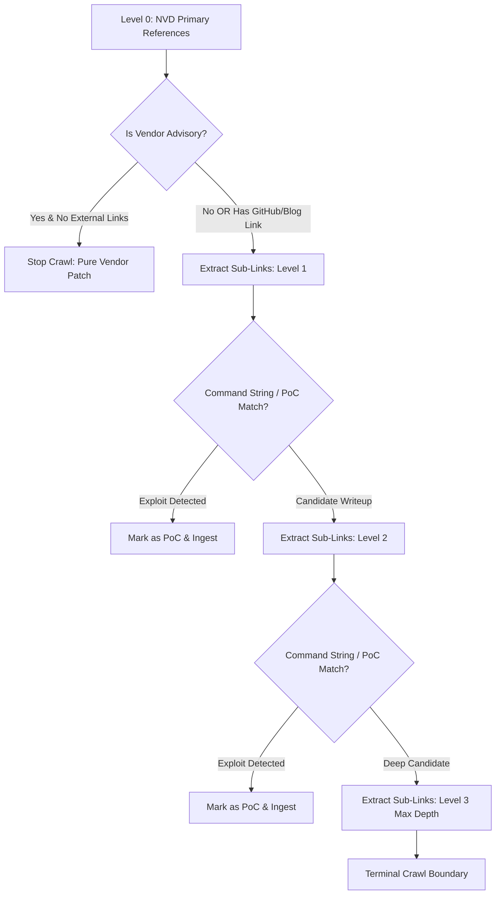

# ATI V2 Architecture & Intelligence Flows

This document visualizes the core algorithmic and architectural flows powering the Automated Threat Intelligence & OSINT Analyzer (ATI V2). More detailed flows for each sub-engine will be added here as the platform evolves.

---

## 1. 3-Level Deep Link Chain Harvester (LV0 → LV3)

This flow illustrates how ATI V2 crawls reference links starting from NVD Level 0 disclosures, traverses up to 3 levels deep (e.g. following repository writeups down to weaponized `.py` or `.sh` exploit scripts), prunes non-exploit vendor portals, and extracts command strings to detect weaponization.

### Flow Notes:
- **Level 0 (LV0)**: Direct advisory and reference URLs provided by NIST NVD 2.0 or CISA KEV.
- **Level 1 (LV1)**: Outbound links found inside LV0 documents (e.g. a blog post or advisory pointing to a GitHub PoC repo).
- **Level 2 (LV2)**: Sub-links within LV1 (e.g. a GitHub repository README linking to a raw exploit script, gist, or paste).
- **Level 3 (LV3)**: Strict terminal boundary to prevent crawler loops and spider traps.
- **Vendor Pruning**: If a link matches known vendor security portals (e.g. Microsoft, Cisco, Siemens) and contains no external technical repository links, crawling terminates at Level 0.

---

## 2. Future Architecture Flows (Under Development)

The following architectural flow diagrams are planned for future documentation iterations:
- **Multi-Provider LLM Dynamic Key Cooldown & Failover Cycle**
- **7-Stream Parallel OSINT Harvesting & Correlation Engine**
- **Zero-Cost IoC Multi-Feed Triangulation (ThreatFox, MalwareBazaar, URLhaus, Shodan)**
- **Owned Assets CPE & Version Matching Engine**
